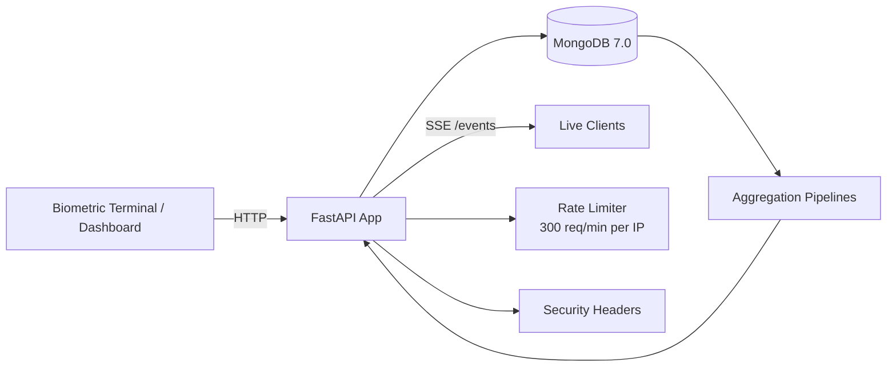
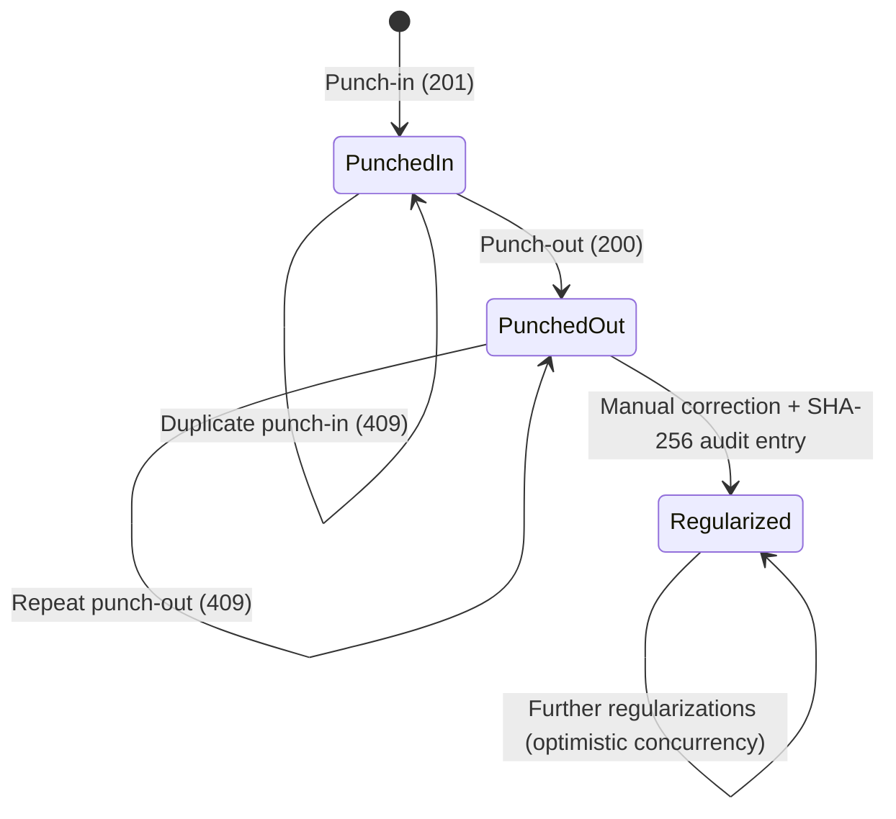
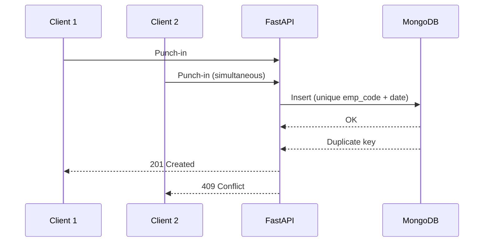

<div align="center">

<!-- Animated waving header -->


<!-- Animated typing banner -->
<a href="https://git.io/typing-svg">
  
</a>

<br/>


-orange?style=flat-square)


<br/>

**[Features](#-features)** •
**[Architecture](#-architecture)** •
**[Business Rules](#-business-rules-r1--r10)** •
**[Concurrency](#-race-safety--concurrency)** •
**[Analytics](#-analytics-endpoints)** •
**[Quick Start](#-quick-start)** •
**[Repository](#-repository-contents)**

</div>

---

## 📖 Overview

> **Enterprise Employee Attendance, Biometric Punch Lifecycle & MongoDB 7.0 Aggregation Analytics Platform**

**PulseHR** is a production-grade **FastAPI + MongoDB** service for:

- 🕒 Tracking employee attendance and punch-in / punch-out business rules
- 🔐 Cryptographic **SHA-256** audit trail for attendance regularizations
- 📡 Real-time **Server-Sent Events (SSE)** push streams
- 📊 High-performance reporting powered by **MongoDB 7.0 aggregation pipelines**

---

## 🧰 Tech Stack

| Layer | Technology |
|:------|:-----------|
| 🐍 **Language** | Python 3.11+ |
| ⚡ **Framework** | FastAPI, Pydantic v2 |
| 🍃 **Database** | MongoDB 6.0+ *(tested against MongoDB 7.0.14)* |
| 🔌 **Driver** | PyMongo 4.7+ |
| 🚀 **Server** | Uvicorn |

---

## ✨ Features

<table>
<tr>
<td width="50%" valign="top">

### 📏 Business Rules (R1 – R10)
- India Standard Time (IST, UTC+05:30)
- Overnight shift support
- 10-minute grace period (`> 10:00`)
- 30-minute minimum overtime threshold
- Mathematical **half-up** rounding via `Decimal`
- Working-days logic

</td>
<td width="50%" valign="top">

### 🛡️ Race Safety & Concurrency
- Atomic `(emp_code, date)` constraint
- Atomic `find_one_and_update` on `punch_out: None`
- Optimistic concurrency control on `history`
- No lost audit trails

</td>
</tr>
<tr>
<td width="50%" valign="top">

### 📈 Aggregations & Analytics
- Monthly presence / leave / late stats
- Cross-collection department summary
- Competition-ranked late leaderboard
- Gap-filled trends with moving averages

</td>
<td width="50%" valign="top">

### 🔎 Explain Endpoint
- Validates index usage on **100k+ records**
- Asserts `IXSCAN`, **0** `COLLSCAN`
- Available at `/admin/explain/{endpoint}`

</td>
</tr>
</table>

---

## 🏗️ Architecture



### 🔄 Punch Lifecycle



---

## 📏 Business Rules (R1 – R10)

| Concern | Rule |
|:--------|:-----|
| 🌏 **Timezone** | Strict India Standard Time (IST, UTC+05:30) |
| 🌙 **Shifts** | Overnight shifts supported |
| ⏱️ **Grace period** | 10 minutes — late if punch-in is after `10:00` |
| ➕ **Overtime** | Counted only at a 30-minute minimum threshold |
| 🔢 **Rounding** | Mathematical half-up using Python `Decimal` |
| 📅 **Working days** | Working-days logic applied to attendance calculations |

---

## 🛡️ Race Safety & Concurrency



| Scenario | Mechanism | Guaranteed Outcome |
|:---------|:----------|:-------------------|
| Simultaneous punch-ins | Atomic constraint on `(emp_code, date)` | Exactly **one 201**, the rest **409** |
| Simultaneous punch-outs | Atomic `find_one_and_update` on `punch_out: None` | Exactly **one 200** |
| Concurrent regularizations | Optimistic concurrency control on `history` | No lost audit trail |

---

## 📊 Analytics Endpoints

| Endpoint | Description |
|:---------|:------------|
| `GET /analytics/employees/{emp_code}/monthly` | Monthly presence, leave, late count, and half-up percentage |
| `GET /analytics/departments/summary` | Cross-collection pipeline counting headcounts with zero logs (R9) and average work hours across records |
| `GET /analytics/leaderboard/late` | Standard competition ranking (1, 2, 2, 4) via `$setWindowFields` + `$rank`, limits applied **post-ranking** |
| `GET /analytics/departments/{department}/trend` | Calendar-gap densification via `$densify` and 7-day moving averages via `$setWindowFields` |
| `GET /admin/explain/{endpoint}` | Query plan validation — `IXSCAN`, 0 `COLLSCAN` on 100k+ records |
| `GET /events` | Server-Sent Events stream for creations, punches, and regularizations |

---

## 🚀 Quick Start

### 1️⃣ Environment & Dependencies

```bash
python -m venv .venv

# Windows
.venv\Scripts\activate

# Linux / macOS
source .venv/bin/activate

python -m pip install -r requirements.txt
```

### 2️⃣ Configure Environment

Set `MONGO_URI` and `MONGO_DB` (or define them in a local `.env`):

```bash
# Default values if omitted:
# MONGO_URI="mongodb://localhost:27017"
# MONGO_DB="attendance_db"
```

### 3️⃣ Seed Realistic Workforce & Attendance

```bash
# Seeds 25 employees across 9 departments with 225 real attendance logs and audit history
python seed_workforce.py
```

### 4️⃣ Run the Application

```bash
uvicorn app.main:app --port 8000
```

> 💡 Indexes are created **idempotently at startup** during the lifespan event — no manual migration needed.

---

## 🖥️ Live Surfaces

| Surface | URL | What you get |
|:--------|:----|:-------------|
| 📊 **Admin Dashboard** | [http://localhost:8000/dashboard](http://localhost:8000/dashboard) (or `/`) | Live KPI cards, interactive biometric punch terminal, 30-day attendance trends, manual correction modal, cryptographic audit log inspection |
| 📘 **OpenAPI Docs** | [http://localhost:8000/docs](http://localhost:8000/docs) | Interactive API documentation |
| 📡 **SSE Stream** | `GET /events` | Instant push updates on employee creations, punches, and regularizations |

<details>
<summary><b>🔒 Enterprise Security (click to expand)</b></summary>

<br/>

- Production headers: `X-Frame-Options`, `X-Content-Type-Options`, `X-RateLimit-Limit`
- IP sliding-window rate limiting: **300 requests / minute**

</details>

<details>
<summary><b>📡 Try the live stream (click to expand)</b></summary>

<br/>

```bash
curl -N http://localhost:8000/events
```

Then punch in from the dashboard and watch events arrive instantly.

</details>

---

## 📂 Repository Contents

```text
candidate_kit/
├── app/
│   └── main.py            # Complete application implementation (single file)
├── sample_data/           # Seed data
├── sample_seed.py         # Seed data loader script
├── seed_workforce.py      # Realistic workforce & attendance seeder
├── requirements.txt       # Python package requirements
├── REVIEW.md              # Detailed audit and defect report for starter code
├── DECISIONS.md           # Indexing, concurrency, ranking, headcount, scaling strategies
├── DATA_MODEL.md          # Collection structures and field conventions
├── openapi.yaml           # OpenAPI 3.0 specification contract
└── README.md              # You are here
```

| File | Purpose |
|:-----|:--------|
| `app/main.py` | Complete application implementation in a single file |
| `requirements.txt` | Python package requirements |
| `REVIEW.md` | Detailed audit and defect report for starter code |
| `DECISIONS.md` | Explanations of indexing, concurrency, ranking, headcount, and scaling strategies |
| `DATA_MODEL.md` | Specification of collection structures and field conventions |
| `openapi.yaml` | OpenAPI 3.0 specification contract |
| `sample_seed.py` & `sample_data/` | Seed data and loader script |

---

<div align="center">


</div>
